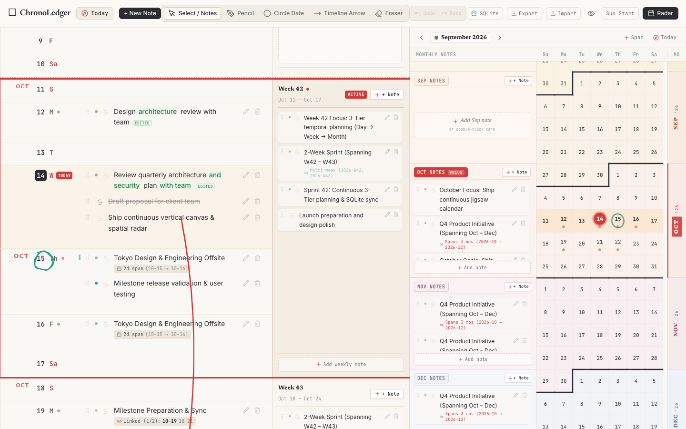

# ChronoLedger

> **Tactile, continuous analog calendar & visual ledger designed for clarity, flow, and focus.**

ChronoLedger blends the continuous spatial awareness of physical wall scrolls and stationery planners with modern digital flexibility. It reimagines traditional grid calendars into an infinite vertical timeline paired with an interconnected month jigsaw radar and freeform margin markup tools.



---

## ✨ Features

- **Infinite Vertical Timeline**: Continuous paper roll displaying months and weeks without artificial page boundaries. Seamlessly scroll across months and years with squarish date cells and red week separator lines.
- **Infinite Bidirectional Month Radar**:
  - Continuous, virtualized multi-month sidebar on the right for long-range planning and rapid jump navigation.
  - Smooth bidirectional infinite scrolling with dynamic month loading and scroll offset stabilization.
  - **1st-of-Month Alignment**: Every month aligns cleanly on the 1st of the month for spatial predictability across years.
  - One-click **Today** snap button to return instantly to the active month.
- **12-Month Subtle Seasonal Gradient Palette**:
  - Distinct ambient color cues assigned to all 12 months across the year:
    - 🌱 **Spring (Mar, Apr, May)**: Soft sage and mint greens.
    - ☀️ **Summer (Jun, Jul, Aug)**: Warm sunshine ambers and light yellows.
    - 🍂 **Autumn (Sep, Oct, Nov)**: Gentle terracotta, peach, and russet oranges.
    - ❄️ **Winter (Dec, Jan, Feb)**: Subtle frosty blues and cool cyans.
  - Harmoniously tints radar tiles, gutters, and monthly note headers, providing instantaneous spatial and temporal orientation when scrolling long distances.
- **Three-Tier Note Hierarchy & Drag-and-Drop Reordering**:
  - **Day Notes**: Quick-entry inputs and tactile note cards attached directly to dates.
  - **Week Notes**: Dedicated weekly focus objectives with responsive viewports that expand naturally as tasks accumulate.
  - **Month Notes**: Long-term monthly notes anchored in the margin gutter and jigsaw radar.
  - **Reordering**: Smooth drag handles (`:::`) on all daily, weekly, and monthly notes for intuitive reorganization. Newly created notes append to the bottom of lists.
- **Semantic Note Annotations, Micro-Badges & Notable Dots**:
  - **Type `@` anywhere in a note** (with keyboard-driven autocomplete and quick-tag bar) to attach rich metadata:
    - 🔴 `@important` (Desert Crimson): Critical priorities; bolds note text and renders red dots in the date gutter.
    - 🟢 `@todo` (Emerald Green): Actionable items and tasks.
    - 🟠 `@wait` / `@await` (Terracotta Orange): Items blocked by or waiting on external events.
    - 🟡 `@celebrate` / `@happy` (Marigold Yellow): Birthdays, milestones, and happy celebrations.
    - 🟣 `@explore` / `@idea` (Amethyst Purple): Exploratory research, ideas, and unknown territory.
    - 🔵 `@thought` / `@revelation` (Estuary Blue): Insights, reflections, and realizations.
    - ⏱️ `@4:00pm` / `@10:30am` (Slate Gray): Specific scheduled times.
    - 🔴 `@failed` / `@fail` (Ruby Red): Failed, rejected, or unsuccessful tasks and events.
    - ⚪ `@skipped` / `@missed` (Ash Gray): Intentionally skipped or missed items without crossing out note text.
  - **Clean Micro-Badges**: Badges hide the literal `@` prefix inside rendered pill tags (e.g. `important`, `todo`), keeping the ledger typography clean while preserving raw `@tag` in text inputs.
  - **Right-Aligned Leading Badge Anchor (Replaces Resting Dot)**:
    - When a note begins with an annotation tag (e.g. `@todo Buy groceries`), the badge replaces the resting note bullet on the left entirely.
    - The badge is right-aligned against the bullet column and bleeds naturally into the left margin, with its colored indicator dot positioned on the right side (`[ todo • ]`).
    - The badge dot and regular note bullets remain 100% vertically aligned, and note body text begins directly at the primary text column across all notes.
    - When resolved (`~~@todo~~`), the badge displays muted strikethrough text and a 45° graphite pencil slash on its right-side dot (`[ ~~todo~~ ⊘ ]`).
    - Middle tags (e.g. `Call @wait for update`) retain standard inline micro-badge styling with the indicator dot on the left (`[ • wait ]`).
  - **Universal Resolution**: All annotations can be marked as resolved (`~~@tag~~`). Clicking any micro-badge toggles its resolution state directly. Striking out an entire note resolves all embedded tags automatically.
  - **Pencil-Slashed Notable Dots**: Date gutter dots track active and resolved annotations by count. Resolved dots remain visible at their date position, crossed out with a crisp 45° diagonal graphite pencil slash.
  - **CommonMark Backslash Escaping**:
    - Typing `\@todo` escapes the tag so it renders as clean plain text `@todo` without turning into a badge.
    - The escaping backslash is consumed in read mode for notebook aesthetics, but preserved in raw storage so opening edit mode displays `\@todo` losslessly (`\\@todo` renders as literal `\` followed by an active badge).
- **Visual Revision Diffs**:
  - Double-click any note to edit in-place.
  - Deleted words are struck through in low-opacity red ink.
  - Newly added words appear in soft green.
  - Completely emptied notes display as crossed-out tasks with an `EDITED` / `DELETED` status tag.
- **Freeform Margin & Markup Tools**:
  - **Pencil (`P`)**: Natural pressure-sensitive freehand sketching in margins and across days using RoughJS and Perfect-Freehand.
  - **Timeline Arrow (`A`)**: Drag between two dates across days or weeks to visually link projects and deadlines.
  - **Continuous Painting Eraser (`E`)**: Real-time hit-testing eraser that lets you brush naturally over strokes to remove them.
- **First-Class Circled Dates**:
  - Double-click any day number on the vertical timeline or radar grid to circle it with an authentic Rough.js hand-drawn ink ring.
  - Single-click an existing circle to cycle through the color palette (Light Gray → Red → Yellow-Orange → Golden Yellow → Purple → Green → Blue).
  - Deterministically seeded so sketchy pen lines never jitter or re-randomize across re-renders or window resizes.
- **Full History Engine (Undo / Redo)**:
  - `⌘Z` / `Ctrl+Z` to undo actions (note deletions, edits, strikethroughs, circled dates, sketches, erasures, reordering).
  - `⌘⇧Z` / `Ctrl+Shift+Z` / `Ctrl+Y` to redo.
  - Native browser undo is fully preserved when typing inside text boxes.
- **Embedded SQLite Database Auto-Sync (`data/chronoledger.sqlite`)**:
  - Live atomic synchronization between browser and disk-persisted SQLite database.
  - High-performance WAL (Write-Ahead Logging) mode and transactional batch writes.
  - Offline-first dual-layer storage: instant browser `localStorage` plus debounced background SQLite commit.
  - Tactile visual sync status badge in the header indicating live sync state and timestamp.
- **Zero-Dependency Production Server & Docker Support**:
  - Ready for local deployment or containerized hosting with Docker and Docker Compose.
  - Built-in zero-dependency Node.js HTTP server.
  - Full JSON backup export and import for data portability and privacy.

---

## ⌨️ Keyboard Shortcuts

| Shortcut | Action |
| :--- | :--- |
| `⌘Z` / `Ctrl+Z` | Undo last action (delete, edit, strike, circle, drawing) |
| `⌘⇧Z` / `Ctrl+Shift+Z` / `Ctrl+Y` | Redo action |
| `T` | Jump to Today |
| `M` | Toggle Month Radar Sidebar |
| `V` | Select / Note Pointer Tool |
| `P` | Pencil Sketching Tool |
| `A` | Timeline Arrow Tool |
| `E` | Continuous Painting Eraser |

---

## 🚀 Getting Started

### Prerequisites

- Node.js (v18+)
- npm

### Development

```bash
# Clone the repository
git clone git@github.com:ericmok/chronoledger.git
cd chronoledger

# Install dependencies
npm install

# Start Vite development server
npm run dev
```

Visit [http://localhost:5173](http://localhost:5173) in your browser.

### Building for Production

```bash
npm run build
```

### Running the Standalone Production Server

ChronoLedger comes with a lightweight, zero-dependency Node.js static server:

```bash
npm start
# Server listens on port 3000 (or PORT env variable)
```

### Docker Deployment

```bash
docker compose up -d
```

Access the app on `http://localhost:3000`.

---

## 🛠️ Architecture

- **React 19 & TypeScript**: Fully typed component hierarchy with modular separation:
  - `src/components/VerticalCalendar.tsx`: Infinite timeline canvas.
  - `src/components/DayRow.tsx`: Date row with weekday badges, today highlighting, and note list.
  - `src/components/WeekFocusPanel.tsx`: Dedicated week ledger and objectives.
  - `src/components/JigsawMonthGrid.tsx`: Interlocking month grid radar.
  - `src/components/DrawingCanvas.tsx`: SVG vector layer for RoughJS sketches, arrows, and circles.
- **Storage & Database Layer**:
  - `server/db.js`: Embedded SQLite database driver powered by Node's built-in `node:sqlite`. Provides WAL mode, transactional writes, and schema tables (`notes`, `week_notes`, `month_notes`, `drawings`, `settings`, `metadata`).
  - `src/services/storage.ts`: Dual-layer storage manager handling instant `localStorage` caching, REST API communication, and JSON backup export/import.
- **State Management**:
  - `src/hooks/useCalendarState.ts`: History stack snapshots, mutation debouncing, tool configuration, and live SQLite database synchronization.

---

## 🛡️ Data Persistence & Safeguards

ChronoLedger implements a multi-tier, zero-loss persistence and synchronization architecture designed to keep user notes, goals, and margin sketches safe at all times:

### 1. Dual-Layer Storage
- **Tier 1 (Instant Local Storage)**: Every note addition, edit, strikethrough, or sketch is written synchronously to browser `localStorage`. You never lose work if the network drops or the tab closes abruptly.
- **Tier 2 (Embedded SQLite with WAL)**: Mutations are debounced (600ms) and committed atomically to an embedded SQLite database at `data/chronoledger.sqlite` using Node's native `node:sqlite` engine with Write-Ahead Logging (`PRAGMA journal_mode = WAL;`).

### 2. Non-Destructive Safe Merging (`safeMerge`)
- During application startup / hydration, the client does **not** blindly overwrite local notes with remote data.
- Instead, collections are merged non-destructively:
  - Items existing only in local storage are preserved and queued to sync to SQLite.
  - Items existing only in SQLite are adopted.
  - Items existing in both sources resolve conflicts using the newest `updatedAt` / `createdAt` timestamp.
- This ensures offline edits or notes entered before sync initialization are never dropped.

### 3. Emergency Recovery Snapshots
- Before any remote sync transaction runs during hydration, ChronoLedger automatically saves an emergency pre-sync snapshot to `chrono_ledger_recovery_snapshot_v1` in browser storage.
- **Console Disaster Recovery**: If you ever need to restore your pre-sync state immediately, open the browser developer console and run:
  ```javascript
  __chronoledger_restore_snapshot()
  ```
  This immediately recovers all notes, drawings, and settings from the recovery snapshot.

### 4. Backup Export & Import
- Use the **Export** button in the header to download an unencrypted, fully portable JSON snapshot (`chronoledger-backup-YYYY-MM-DD.json`).
- Use the **Import** button to restore from any backup file at any time.

---

## 📄 License

MIT
