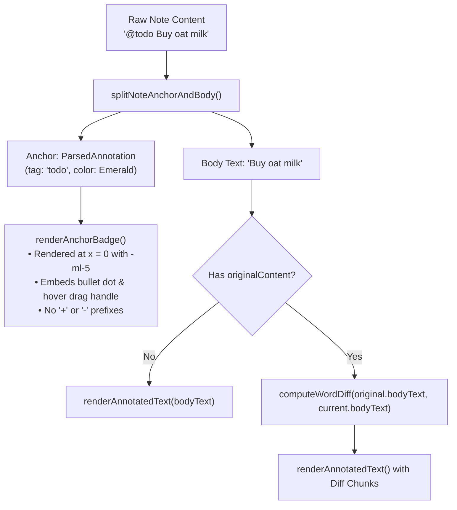
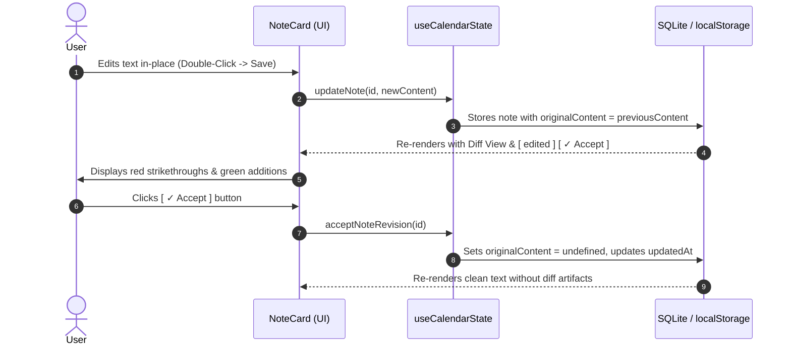

# Architecture & Technical Specification: Annotations, Anchor Fusing, and Semantic Diffs

> **Status:** Production / Implemented  
> **Target Audience:** Core Developers, Contributors, and System Architects  
> **Modules Involved:** [`src/utils/annotationUtils.ts`](../src/utils/annotationUtils.ts), [`src/utils/diffUtils.ts`](../src/utils/diffUtils.ts), [`src/components/common/NoteCard.tsx`](../src/components/common/NoteCard.tsx), [`src/hooks/useCalendarState.ts`](../src/hooks/useCalendarState.ts)

---

## 1. Design Intent & Philosophy

ChronoLedger is built around the tactile aesthetics and permanence of a physical **analog paper ledger**. In a physical notebook or ledger:
1. **Ink is permanent**: Words are not silently deleted or rewritten without a trace; edits are crossed out with a single pen stroke, preserving editorial intention and context.
2. **Status is distinct from editorial content**: Ticking a checkbox or striking through a completed task changes its *lifecycle state*, not the underlying prose.
3. **Card alignment is sacred**: Notes must maintain a predictable vertical rhythm and alignment grid ($x = 0$), whether they possess metadata or plain prose.

Prior iterations suffered from conflating **Lifecycle State** (e.g. `@todo` $\leftrightarrow$ `~~@todo~~`) with **Editorial Diffing** (revising text). Treating a tag resolution as an editorial change caused the diff algorithm to interpret task completion as a deletion and insertion, duplicating tags on click and breaking visual fusion.

The current architecture decouples these layers through an **Anchor-First / Body-Diff Architecture**:
- **Lifecycle state transitions** (active $\leftrightarrow$ resolved) are decoupled from text diffs and never trigger editorial badges.
- **Leading tags fuse at $x = 0$** with the bullet dot and drag handle, forming the card's visual identity.
- **Word-level diffs are restricted to prose and inline tags**, showing deleted words in red strikethrough and added words in green, with an explicit **`✓ Accept`** action to finalize revisions.

```
+-----------------------------------------------------------------------------------------+
|                                    NOTE ARCHITECTURE                                    |
|                                                                                         |
|  [ x = 0 ]                                                                              |
|  +---------------------+   +---------------------------------------------------------+  |
|  |    ANCHOR SLOT      |   |                       BODY SLOT                         |  |
|  |                     |   |                                                         |  |
|  |  • Leading Tag      |   |  • Sentence Prose                                       |  |
|  |  • Bullet Dot       |   |  • Inline Tags (@tag)                                   |  |
|  |  • Drag Handle      |   |  • Word-Level Diffing Engine (LCS)                      |  |
|  |  • No Diff Prefixes |   |  • [ + TAG ] / [ ~~TAG~~ (opacity 50%) ]                |  |
|  +---------------------+   +---------------------------------------------------------+  |
|                                                                                         |
|  Controlled by:            Controlled by:                                               |
|  splitNoteAnchorAndBody    computeWordDiff (with areTokensEquivalent)                   |
+-----------------------------------------------------------------------------------------+
```

---

## 2. Standard Terminology

To prevent conceptual ambiguity across PRs and discussions, the following standard terms are established:

| Term | Scope | Definition & Syntax |
| :--- | :--- | :--- |
| **Annotation** | System | The overarching semantic system that parses raw markdown into structured metadata chips, gutter dots, and calendar filters. |
| **Tag** | Syntax | The raw text syntax typed by the user (e.g. `@todo`, `@wait`, `@important`, `@4:00pm`). |
| **Anchor Tag** | Position | The first non-whitespace tag appearing at the very beginning of a note string. |
| **Inline Tag** | Position | Any tag appearing inside the prose body or at the end of the note. |
| **Anchor Badge** | UI Component | The fused chip rendered at $x = 0$ (`[ • TODO ]`). Absorbs the note's resting bullet dot and hover drag handle. |
| **Inline Badge** | UI Component | A micro-chip rendered within sentence flow (`[ TODO ]`). Has no negative margins, no bullet dot, and no drag handle. |
| **Notable Dot** | Gutter | The small colored indicator in the date number column representing notes with active or resolved annotations. |

---

## 3. Data Model & Storage

Notes are stored as plain markdown strings with optional revision tracking:

```typescript
export interface NoteItem {
  id: string;
  content: string;             // Current raw markdown (e.g. "@todo Review budget @finance")
  originalContent?: string;    // Pre-revision markdown snapshot for diff rendering
  isStruck: boolean;           // Entire note strikeout (graphite pencil line across note)
  parentDates: string[];       // Associated calendar dates (YYYY-MM-DD)
  colorTag?: string;           // Optional fallback tint
  createdAt: string;
  updatedAt: string;
}
```

### Syntax Specifications

1. **Active Tag**: `@<tagname>` (e.g. `@todo`, `@important`, `@4:30pm`).
2. **Resolved Tag**: `~~@<tagname>~~` (CommonMark strikethrough markers wrapping the tag).
3. **Escaped Tag**: `\@<tagname>` (CommonMark backslash escape). In read mode, the backslash is consumed so the text displays literally as `@todo` without turning into a chip. In edit mode, the backslash is preserved losslessly.
4. **Note-Level Strike**: `isStruck = true` overrides all inner tags; all annotations render as resolved, and the entire card receives a graphite pencil strikethrough line.
5. **Future Parameterized Tags**: Designed to support key-value pairs (e.g. `@todo[work]`, `@exercise[energy=low]`).

---

## 4. Anchor Fusing Architecture ($x = 0$)

### The Visual Problem

Every note card in ChronoLedger aligns along a strict vertical grid line:
- **Untagged notes** render a standalone bullet dot (`•`) at $x = 0$, which transitions to a reordering drag handle (`:::`) on hover.
- **Tagged notes** with a leading tag render a saturated category badge. If the tag were rendered after the bullet, the extra horizontal offset would create an awkward indent and double-dot visual noise (`• [ • TODO ]`).

### The Fused Solution

The function `splitNoteAnchorAndBody()` parses the note into two separate compartments:

```typescript
export interface SplitNoteResult {
  anchor: ParsedAnnotation | null;
  bodyText: string;
}
```



#### Key Rules for Anchor Badges:
1. **Resting Bullet Dot**: Embedded inside the badge (`<circle cx="4" cy="4" r="3.2" />`).
2. **Drag Handle**: Replaces the bullet dot when hovered (`<GripVertical />`).
3. **Negative Margin**: Uses `-ml-5` (comfortable density) or `-ml-4` (compact density) to pull the badge directly into the slot where the standalone bullet dot normally lives.
4. **Standalone Slot Suppression**: When `currentSplit.anchor` exists, the standalone bullet slot is completely omitted from the DOM, guaranteeing zero horizontal shift.
5. **No Diff Prefix**: Even if an anchor was newly added in an edit (`buy milk` $\to$ `@todo buy milk`), the anchor badge never receives a `+` symbol; its placement at $x = 0$ is sufficient to denote card identity.

---

## 5. Semantic Diff Engine (`diffUtils.ts`)

### Why Naive Diffing Failed
A standard character or word diff algorithm compares strings strictly:
$$\text{"@todo"} \neq \text{"~~@todo~~"}$$

This caused three major bugs:
1. Clicking `@todo` to resolve it was reported as a deletion of `@todo` and addition of `~~@todo~~`.
2. The UI rendered `@todo` twice: once in red strikethrough, and once in green.
3. Resolving a tag triggered the `[ edited ]` audit badge, permanently dirtying the note's revision state.

### The Resolution-Aware Algorithm

The diff engine implements an LCS (Longest Common Subsequence) comparison with semantic tag normalization:

```typescript
function stripTagResolution(token: string): string {
  if (!token) return '';
  const match = token.match(/^(?:~~)?(@[a-zA-Z0-9]+(?:[:.-][a-zA-Z0-9]+)*(?:[ap]m)?)(?:~~)?$/i);
  return match ? match[1].toLowerCase() : token;
}

function areTokensEquivalent(t1: string, t2: string): boolean {
  if (t1 === t2) return true;
  const s1 = stripTagResolution(t1);
  const s2 = stripTagResolution(t2);
  if (s1.startsWith('@') && s2.startsWith('@')) {
    return s1 === s2;
  }
  return false;
}
```

#### Tokenizer Behavior
The tokenizer isolates tags, whitespace sequences, and word punctuation runs:
```regexp
/(?:~~)?@[a-zA-Z0-9]+(?:[:.-][a-zA-Z0-9]+)*(?:[ap]m)?(?:~~)?|\s+|[^\s]+/gi
```

#### Backtracking Preservation
When backtracking through the DP table, when two tokens match via `areTokensEquivalent`, the engine pushes the **new token's value** into an `unchanged` chunk:
```typescript
if (i > 0 && j > 0 && areTokensEquivalent(oldTokens[i - 1], newTokens[j - 1])) {
  rawChunks.push({ type: 'unchanged', value: newTokens[j - 1] });
  i--;
  j--;
}
```

**Result**:
- Toggling `@todo` $\to$ `~~@todo~~` produces a single `unchanged` chunk with value `~~@todo~~`.
- No deleted chunks or added chunks are generated.
- The note does **not** enter diff mode, and no tags are duplicated.

---

## 6. Diff Display Rules for Prose & Inline Tags

When real edits occur (`originalSplit.bodyText` $\neq$ `currentSplit.bodyText`), `bodyDiffChunks` generates visual diffs:

```
+------------------------------------------------------------------------------------------+
| EDIT SCENARIOS & RENDERING BEHAVIOR                                                      |
+------------------------------------------------------------------------------------------+
| 1. Text Added:                                                                           |
|    "milk" -> "cold milk"                                                                 |
|    Renders: [ cold ] (soft green background #E8F5E9, text #1E7B48) + milk               |
|                                                                                          |
| 2. Text Deleted:                                                                         |
|    "buy whole milk" -> "buy milk"                                                        |
|    Renders: buy + [ ~~whole~~ ] (red strikethrough line #D23B38, opacity 60%) + milk      |
|                                                                                          |
| 3. Inline Tag Added:                                                                     |
|    "Call Alice" -> "Call Alice @urgent"                                                  |
|    Renders: Call Alice + [ + URGENT ] (full category chip with '+' prefix)               |
|                                                                                          |
| 4. Inline Tag Deleted:                                                                   |
|    "Call Alice @urgent" -> "Call Alice"                                                  |
|    Renders: Call Alice + [ ~~URGENT~~ ] (category chip, opacity 50%, NO '-' prefix)      |
|                                                                                          |
| 5. Anchor Tag Replaced:                                                                  |
|    "@todo Buy milk" -> "@wait Buy milk"                                                  |
|    Renders: [ • WAIT ] at x = 0 + [ ~~TODO~~ ] at start of body diff + Buy milk          |
+------------------------------------------------------------------------------------------+
```

### Styling Constraints Mandated for Diffs:
- **No `−` Prefix for Deleted Tags**: Strikethrough already communicates deletion. Adding a minus symbol (`-`) creates visual clutter.
- **Lower Opacity (`opacity-50`)**: Deleted tags are dimmed to prevent them from competing with active badges.
- **Category Colors Maintained**: Deleted tags retain their authentic category tint (`bgColor` and `textColor`) rather than turning into uniform red text.

---

## 7. The Revision Lifecycle & `✓ Accept` Workflow

Diffs in ChronoLedger are persistent until the user explicitly accepts them.



### Propagated Callback Hierarchy
The `acceptNoteRevision` callback is wired through the entire application hierarchy:
- **App.tsx**: Destructures `acceptNoteRevision` from `useCalendarState()`.
- **Daily Notes Tier**: `VerticalCalendar` $\to$ `DayRow` $\to$ `NoteItemComponent` $\to$ `NoteCard (onAcceptEdit)`.
- **Weekly Notes Tier**: `VerticalCalendar` $\to$ `WeekFocusPanel` $\to$ `NoteCard (onAcceptEdit)`.
- **Monthly Notes Tier**: `JigsawMonthGrid` $\to$ `MonthNotesColumn` $\to$ `NoteCard (onAcceptEdit)`.

---

## 8. Future Roadmap: Attribute-Value Annotations

The current syntax parser and diff engine are designed to support parameterized key-value annotations:

### Anticipated Syntax
```markdown
@todo[project=chronoledger, priority=high] Fix virtualizer offset
@exercise[type=running, distance=5km, energy=low]
@wait[for=@alice, until=2026-10-20]
```

### Architectural Readiness
1. **Tokenizer Isolation**: The tag regex in `diffUtils.ts` and `annotationUtils.ts` will extend `(?:\[[^\]]*\])?` to capture attribute blocks as part of the tag token.
2. **Equivalence Evaluation**: `areTokensEquivalent` will compare `tag` identifiers while allowing attribute differences to optionally participate in property-level diffing.
3. **Anchor Fusing Compatibility**: The anchor splitter evaluates the first token. Attribute extensions will remain inside `anchor.raw` without affecting bullet dot fusion or drag handle behavior at $x = 0$.
