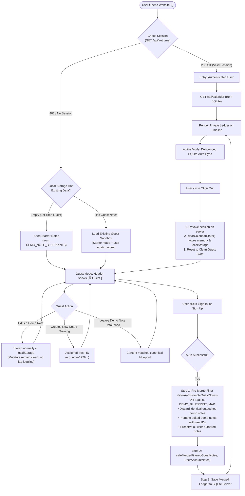

# Authentication, Multi-Tenant Sessions, and Note Migration

> A technical specification and architectural guide for ChronoLedger's guest sandbox, multi-user authentication, dual-mode sessions, and zero-loss data migration.

---

## 1. Background and Philosophy

ChronoLedger is designed as a **local-first, tactile analog calendar**. Because users value instantaneous flow without upfront friction, the application does not impose a mandatory registration wall. Anyone can visit the site and immediately start handwriting notes, sketching arrows in margins, and circling milestone dates.

However, as soon as a user desires multi-device synchronization (e.g. accessing their calendar on a phone, iPad, or another computer), data must be secured behind authenticated credentials.

This creates a dual requirement:
1. **Guest Mode (Local-First Sandbox)**: Unauthenticated visitors can create notes, circle dates, and explore the app with all data persisted strictly in browser `localStorage`.
2. **Account Protection (Private Multi-Tenant Ledger)**: Once a user registers or logs in, their notes are stored in the server's SQLite database (`data/chronoledger.sqlite`), scoped by their `user_id`. When they log out, private notes are immediately wiped from the screen and local storage to prevent data leakage on shared computers.

---

## 2. Session Lifecycle & State Machine

The following flowchart illustrates every state transition—from first-time visitor to authenticated sync, guest note promotion, and protected logout:



---

## 3. The 6 User Entry Points

ChronoLedger deterministically handles six entry points:

| Entry Point | Client State | System Action |
| :--- | :--- | :--- |
| **1. First-Time Visitor** | No cookies, empty `localStorage` | Boots in **Guest Mode**. Seeds initial starter notes from `DEMO_NOTE_BLUEPRINTS`. Header displays `[ 🗄️ Guest ]` and `[ Sign In ]`. |
| **2. Returning Guest** | No cookies, existing `localStorage` | Restores local scratchpad. Demo notes that remain untouched match `DEMO_BLUEPRINT_MAP` and will be discarded on login. Any edited or newly created items are preserved locally. |
| **3. Returning Authenticated User** | Valid 30-day session cookie | Seamlessly boots into private account. Calls `GET /api/calendar` to fetch the user's private ledger from SQLite. Header displays `[ 👤 email ]` and `[ 🗄️ SQLite ]`. |
| **4. Expired Session** | Cookie >30 days old or revoked | `/api/auth/me` returns `401`. App preserves unsynced in-progress text in local storage and sets status to `[ ⚠️ Re-auth ]`, allowing one-click re-authentication without losing work. |
| **5. Account Switcher** | User logs out of Alice, logs into Bob | Logging out of Alice completely wipes memory and `localStorage`. Logging into Bob loads only Bob's private notes—guaranteeing zero cross-account data leakage. |
| **6. Multi-Device Stale State** | Edited note on iPhone; laptop woke from sleep | When laptop tab regains focus (`visibilitychange`), it fetches the latest updates from SQLite rather than overwriting with stale sleep memory. |

---

## 4. The Demo Note Protocol (Single Source of Truth)

When a guest explores the application, the calendar displays sample notes (e.g., *"Tokyo Design Offsite"*, *"Review architecture plan"*). If that guest subsequently registers or logs into an existing account, **their personal account must not be polluted with sample notes**.

To achieve this cleanly without duplicating strings or burdening every note mutator in the codebase with special-case flags:

1. **Single Source of Truth (`src/services/demoNotes.ts`)**:
   `DEMO_DAY_NOTE_BLUEPRINTS`, `DEMO_WEEK_NOTE_BLUEPRINTS`, and `DEMO_MONTH_NOTE_BLUEPRINTS` define the canonical starter notes in one place. Both note generation and login verification derive directly from these blueprints.
2. **Clean Mutators (Zero Runtime Overhead)**:
   All 18 note mutators (`toggleStrike`, `update`, `reorder`, `move`, etc.) remain completely clean, idiomatic state operations. They have zero awareness of demo notes and do not mutate IDs or toggle flags mid-session.
3. **Pristine Template Diffing (`filterAndPromoteGuestNotes`)**:
   Because starter notes have canonical IDs and contents in `DEMO_BLUEPRINT_MAP`, we evaluate notes strictly at the moment of login/rehydration:
   * **Untouched Demo Notes**: If a note's ID matches a demo blueprint and its content and strike status are identical to the blueprint, it is identified as untouched demo fluff and discarded.
   * **Edited Demo Notes**: If a user typed new content or struck/unstruck a demo note, it differs from the blueprint. It is automatically promoted with a fresh non-colliding ID (`note-${Date.now()}-${random}`) and preserved.
   * **User-Authored Notes**: Any note created by the user has a custom ID not in the blueprint map, so it is preserved 100%.
4. **Friction-Free Merge on Login**:
   When authenticating:
   ```ts
   // Discard untouched demo notes; promote any edited demo notes to persistent IDs
   const activeLocalNotes = filterAndPromoteGuestNotes(currentStateRef.current.notes, 'note');
   const mergedNotes = safeMerge(activeLocalNotes, remoteUserNotes);
   ```
   * Untouched demo notes silently evaporate.
   * Any guest work the user created or edited is seamlessly merged into their private account and persisted to SQLite.

---

## 5. Dual-Mode Authentication (Web + Rust / Native Clients)

To support web browsers alongside future native clients (e.g. a Rust desktop client, iOS SwiftUI app, or CLI scripts), the backend implements **Dual-Mode Authentication**:

```mermaid
flowchart LR
    subgraph Clients
        Web["Web Browser (React)"]
        Rust["Desktop / Native (Rust, iOS, CLI)"]
    end

    subgraph AuthEndpoint["POST /api/auth/login"]
        Web --> AuthEndpoint
        Rust --> AuthEndpoint
    end

    AuthEndpoint --> Response["Response:<br>1. Set-Cookie: session_token=... (for Web)<br>2. JSON: { token, user } (for Native)"]

    subgraph Resource["GET /api/calendar"]
        Web -->|"Cookie: session_token=..."| Resource
        Rust -->|"Authorization: Bearer <token>"| Resource
    end
```

### Server Token Resolver
On every API request (`/api/*`), `server/auth.js` checks:
1. `Authorization: Bearer <token>` header (used by Rust, iOS, and curl).
2. If omitted, falls back to the `Cookie: session_token=<token>` header (used by web browsers).

Session tokens are stored in the database as **SHA-256 hashes** (`token_hash`), ensuring that a database dump does not reveal usable session tokens. Passwords are encrypted using **Argon2id**.

---

## 6. Database Schema (Schema v4)

In `data/chronoledger.sqlite`, tables are partitioned by `user_id`:

```sql
-- Users Table
CREATE TABLE IF NOT EXISTS users (
  id TEXT PRIMARY KEY,
  email TEXT UNIQUE NOT NULL COLLATE NOCASE,
  password_hash TEXT NOT NULL,
  created_at TEXT NOT NULL
);

-- Sessions Table (multi-device support)
CREATE TABLE IF NOT EXISTS sessions (
  token_hash TEXT PRIMARY KEY,
  user_id TEXT NOT NULL REFERENCES users(id) ON DELETE CASCADE,
  device_name TEXT,
  client_type TEXT,
  ip_address TEXT,
  expires_at TEXT NOT NULL,
  created_at TEXT NOT NULL
);

CREATE INDEX IF NOT EXISTS idx_sessions_user_id ON sessions(user_id);

-- Calendar Tables with user_id
ALTER TABLE notes ADD COLUMN user_id TEXT;
ALTER TABLE week_notes ADD COLUMN user_id TEXT;
ALTER TABLE month_notes ADD COLUMN user_id TEXT;
ALTER TABLE drawings ADD COLUMN user_id TEXT;
ALTER TABLE circled_dates ADD COLUMN user_id TEXT;
ALTER TABLE settings ADD COLUMN user_id TEXT;

CREATE INDEX IF NOT EXISTS idx_notes_user_id ON notes(user_id);
CREATE INDEX IF NOT EXISTS idx_week_notes_user_id ON week_notes(user_id);
CREATE INDEX IF NOT EXISTS idx_month_notes_user_id ON month_notes(user_id);
CREATE INDEX IF NOT EXISTS idx_drawings_user_id ON drawings(user_id);
CREATE INDEX IF NOT EXISTS idx_circled_dates_user_id ON circled_dates(user_id);
```

### User-Scoped Read and Write Queries
Instead of global table wipes, all writes are isolated to the active session's `user_id`:
```sql
DELETE FROM notes WHERE user_id = :userId;
INSERT INTO notes (id, user_id, content, ...) VALUES (:id, :userId, :content, ...);
```

---

## 7. Edge Cases and Defensive Mitigations

### A. The "Deleted Demo Note" Trap
* **Issue**: A guest deletes 5 demo notes, then logs into their existing account. If a deletion event were recorded, would it delete 5 notes from their account?
* **Mitigation**: Deletion in guest mode only removes the item from the local array. Merging only evaluates existing non-demo items. Account notes are never deleted by guest actions.

### B. Concurrency & Stale Tab Overwriting
* **Issue**: A user edits their calendar on their phone at 2:00 PM. Their laptop had a browser tab open from 1:00 PM. When they open their laptop, an auto-sync could push the stale 1:00 PM state and overwrite the phone's 2:00 PM edit.
* **Mitigation**: On `document.visibilitychange` (`state === 'visible'`), the browser calls `rehydrateRemoteCalendar()` to pull the latest remote timestamp before any local mutation can schedule a push.

### C. Drawings & Circled Dates in Guest Mode
* **Rule**: Because ChronoLedger does not ship with placeholder demo drawings or demo circles, **any drawing stroke or circled date created in guest mode is genuine user work**. All local drawings and circled dates are preserved and merged upon login.

### D. Logout Privacy Wipe
* **Rule**: Clicking **Sign Out** immediately:
  1. Revokes the session token in SQLite via `POST /api/auth/logout`.
  2. Calls `clearCalendarState()`, resetting in-memory notes, week notes, drawings, and circled dates to empty arrays.
  3. Clears `localStorage` and removes `chrono_ledger_recovery_snapshot_v1`.
  4. Returns the UI to a clean Guest state.

### E. Password Change & Device Invalidation
* **Endpoint**: `POST /api/auth/change-password`
* **Rule**: When a user changes their password:
  1. The server verifies their `currentPassword` using Argon2id.
  2. The new password is validated (minimum 6 characters) and hashed with Argon2id.
  3. `users.password_hash` is updated atomically.
  4. **Multi-device Invalidation**: All other sessions in `sessions` table are deleted (`user_id = ? AND token_hash != ?`), forcing lost, stolen, or remote devices to re-authenticate. The active session remains authenticated.
  5. Endpoints are protected by a sliding-window rate limiter (10 attempts/min).

### F. Personal Access Tokens (PAT) & MCP Tooling
* **Endpoints**: `GET /api/auth/tokens`, `POST /api/auth/tokens`, `DELETE /api/auth/tokens/:id`
* **Rule**: AI agents (Claude Desktop, Antigravity, Cursor) and CLI tooling authenticate via Personal Access Tokens (`cal_pat_...`) passed as Bearer tokens or via `CHRONOLEDGER_TOKEN` environment variables.
* **Security Standards**:
  - LLMs never prompt users for primary passwords.
  - Raw tokens are returned only once upon creation; only SHA-256 hashes are persisted at rest in `api_tokens`.
  - Tokens can be revoked individually from the Account & Security Settings UI without changing master passwords.
