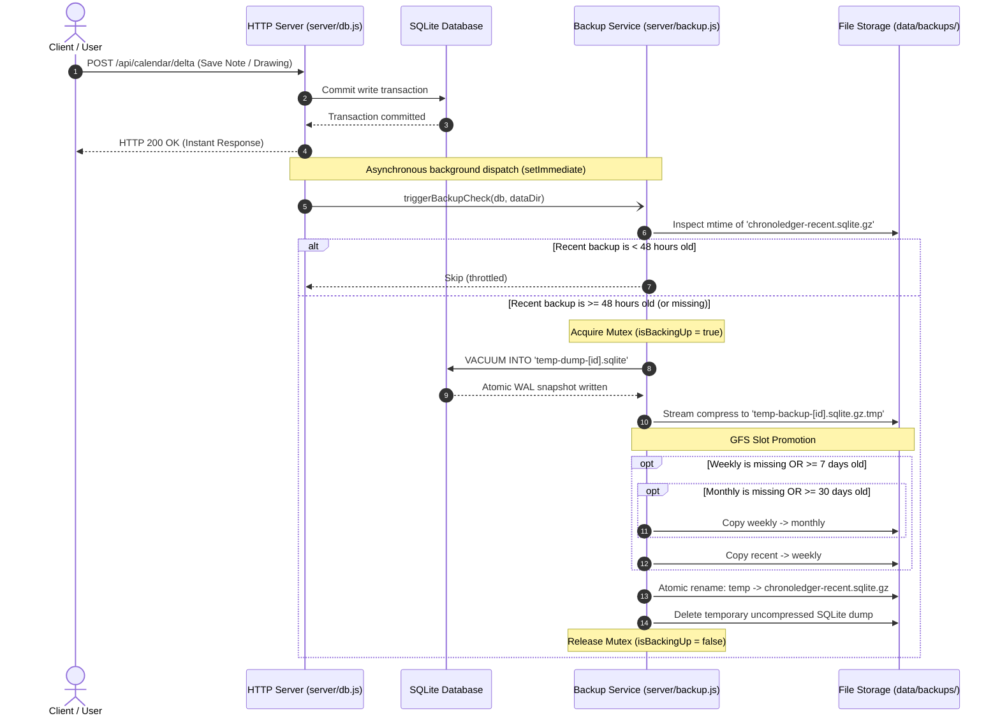

# ChronoLedger Backup & Disaster Recovery Architecture

ChronoLedger implements an automated, lightweight, **Grandfather-Father-Son (GFS)** backup subsystem designed for high efficiency, multi-user safety, and minimal disk storage.

---

## 1. Overview & Core Philosophy

Instead of relying on heavy external background daemons or uncompressed file copies, the backup system adheres to four core design principles:

1. **Strictly Limited Storage (Exactly 3 Files):**
   The system maintains at most three fixed, Gzip-compressed snapshot files in `data/backups/`. Disk usage is permanently bounded (typically **under 3–5 MB total** across all three tiers).
2. **Opportunistic On-Write Triggering (Zero Waste When Idle):**
   Backups only run when a user modifies calendar data and at least **48 hours** have elapsed since the last backup. When no one is writing, zero CPU cycles or disk writes are consumed.
3. **Non-Blocking User Experience:**
   Backups execute asynchronously in the background (`setImmediate`). A user's HTTP save request (`POST /api/calendar/delta`) returns `200 OK` instantly and never waits for disk or gzip operations.
4. **PostgreSQL-Ready Abstraction:**
   The snapshot engine is isolated into a single swappable function. When migrating from SQLite to PostgreSQL, the scheduling, rotation, and file retention logic remain 100% unchanged.

---

## 2. The GFS (Grandfather-Father-Son) 3-Tier Model

All backups are stored in `data/backups/`:

```text
data/
├── chronoledger.sqlite
├── chronoledger.sqlite-wal
└── backups/
    ├── chronoledger-recent.sqlite.gz   (Son: latest state, >= 2 days old)
    ├── chronoledger-weekly.sqlite.gz   (Father: milestone from >= 7 days ago)
    └── chronoledger-monthly.sqlite.gz  (Grandfather: milestone from >= 30 days ago)
```

| Backup Slot | Role | Update Condition | Purpose |
| :--- | :--- | :--- | :--- |
| **`chronoledger-recent.sqlite.gz`** | **Son (Recent)** | Triggered on write if $\ge 48$ hours have elapsed | Short-term safety net against recent mistakes or crashes |
| **`chronoledger-weekly.sqlite.gz`** | **Father (Weekly)** | Promoted from `recent` when $\ge 7$ days old | Protection against corruption noticed a few days later |
| **`chronoledger-monthly.sqlite.gz`** | **Grandfather (Monthly)** | Promoted from `weekly` when $\ge 30$ days old | Long-term archival recovery point |

### Why GFS Beats Simple FIFO Rotation
In a naive 2-file FIFO system, if a user accidentally corrupts data on Monday and other users make edits on Wednesday and Friday, both backup slots are overwritten with the corrupted state within 4 days. 

With GFS, the **Weekly** (7 days ago) and **Monthly** (30 days ago) snapshots remain untouched as historical anchors.

---

## 3. Workflow Architecture



---

## 4. Multi-User Safety & Disaster Recovery Runbooks

ChronoLedger stores all users, logins, passwords, sessions, notes, drawings, and circled dates in the same relational database.

### Scenario A: Full System Disaster Recovery (Server Crash / Corrupt File)
If the host server crashes or the active `chronoledger.sqlite` file is lost:

1. Stop the ChronoLedger server process or container:
   ```bash
   docker compose down
   # or kill server PID
   ```
2. Decompress your chosen backup slot into the live database location:
   ```bash
   gzip -dc data/backups/chronoledger-recent.sqlite.gz > data/chronoledger.sqlite
   ```
3. Restart the server:
   ```bash
   docker compose up -d
   ```
*Result: All user accounts, passwords, notes, and settings are restored with 100% fidelity.*

---

### Scenario B: Selective Single-User Restore (Without Affecting Other Users)
If **Alice** accidentally deletes a month of notes, but **Bob** has written new work this week that cannot be rolled back:

1. Decompress the historical backup into a temporary file:
   ```bash
   gzip -dc data/backups/chronoledger-weekly.sqlite.gz > /tmp/backup_snapshot.sqlite
   ```
2. Run a targeted SQLite query to copy **only Alice's records** back into the live database:
   ```bash
   node -e "
   const { DatabaseSync } = require('node:sqlite');
   const db = new DatabaseSync('data/chronoledger.sqlite');
   db.exec(\"ATTACH DATABASE '/tmp/backup_snapshot.sqlite' AS backup_db;\");
   
   // Replace Alice's notes from the backup snapshot
   db.exec(\"DELETE FROM notes WHERE user_id = 'alice_user_id';\");
   db.exec(\"INSERT OR REPLACE INTO notes SELECT * FROM backup_db.notes WHERE user_id = 'alice_user_id';\");
   
   db.exec(\"DETACH DATABASE backup_db;\");
   console.log('Restored Alice notes cleanly without rolling back other users!');
   "
   ```
3. Remove the temporary `/tmp/backup_snapshot.sqlite` file.

---

## 5. REST API & Observability

ChronoLedger provides native endpoints to inspect backup status and trigger on-demand snapshots.

### `GET /api/backups`
Returns detailed metadata for all three GFS slots:

```json
{
  "backupsDir": "/app/data/backups",
  "isBackingUp": false,
  "lastFailure": null,
  "files": {
    "recent": {
      "exists": true,
      "path": "/app/data/backups/chronoledger-recent.sqlite.gz",
      "sizeBytes": 425120,
      "sizeFormatted": "415.2 KB",
      "modifiedAt": "2026-10-29T14:30:00.000Z",
      "ageHours": 1.2,
      "ageDays": 0.1
    },
    "weekly": {
      "exists": true,
      "path": "/app/data/backups/chronoledger-weekly.sqlite.gz",
      "sizeBytes": 412980,
      "sizeFormatted": "403.3 KB",
      "modifiedAt": "2026-10-22T10:15:00.000Z",
      "ageHours": 172.5,
      "ageDays": 7.2
    },
    "monthly": {
      "exists": false
    }
  }
}
```

### `POST /api/backups`
Forces an immediate on-demand backup, bypassing the 48-hour freshness throttle (useful before applying major manual migrations or server reboots).

### `GET /api/health`
The health check endpoint includes the `backup` status object so uptime monitors (like Prometheus, Uptime Kuma, or AWS Route53) can alert if backups become stale or encounter errors.

---

## 6. Migration Guide: Switching to PostgreSQL

When migrating ChronoLedger to PostgreSQL in the future, the backup system is already prepared.

### The Swap Point in `server/backup.js`
In [`server/backup.js`](file:///Users/dove/Code/CalendarApp/desert-estuary-calendar/server/backup.js), locate `dumpDatabase()`:

```javascript
// === TODAY (SQLite) ===
export async function dumpSqliteDatabase(db, targetFilePath) {
  const safePath = targetFilePath.replace(/'/g, "''");
  db.exec(`VACUUM INTO '${safePath}'`);
}

// === FUTURE (PostgreSQL) ===
export async function dumpPostgresDatabase(targetGzipPath, connectionString = process.env.DATABASE_URL) {
  const { spawn } = await import('node:child_process');
  const proc = spawn('pg_dump', [connectionString, '-Fc', '--no-owner', '--no-privileges'], {
    stdio: ['ignore', 'pipe', 'pipe'],
  });

  const writeStream = fs.createWriteStream(targetGzipPath);
  const gzip = zlib.createGzip({ level: 9 });

  await pipeline(proc.stdout, gzip, writeStream);
}
```

### Why Postgres Backups Are Even Faster
In SQLite, `VACUUM INTO` creates an uncompressed `.sqlite` file on disk before Node compresses it to `.sqlite.gz`. 

In PostgreSQL, `pg_dump` can pipe its `stdout` stream directly through `zlib.createGzip()` into the file with **zero intermediate disk space spike**.

---

## 7. Edge Cases & Resilience Safeguards

| Operational Hazard | How the System Protects You |
| :--- | :--- |
| **Server Crash Mid-Backup** | Backups write to `temp-[runId].sqlite.gz.tmp` first. The file is only moved to `chronoledger-recent.sqlite.gz` via an atomic POSIX rename (`fs.renameSync`) once Gzip completes cleanly. |
| **Abandoned Temp Files** | On server startup and during maintenance routines, `cleanOrphanedTempFiles()` automatically purges any lingering `.tmp` files. |
| **Error Retry Storms** | If a disk runs out of space, the system enters a **30-minute cooldown** (`ERROR_COOLDOWN_MS`). Subsequent user keystrokes will not spam failing backup routines. |
| **Concurrent Write Contention** | An in-memory mutex (`isBackingUp = true`) ensures multiple users saving at the same moment will never execute overlapping backup routines. |
| **Anonymous In-Memory Tests** | `triggerBackupCheck` automatically detects `:memory:` databases and avoids creating unwanted backup files during unit test runs. |
