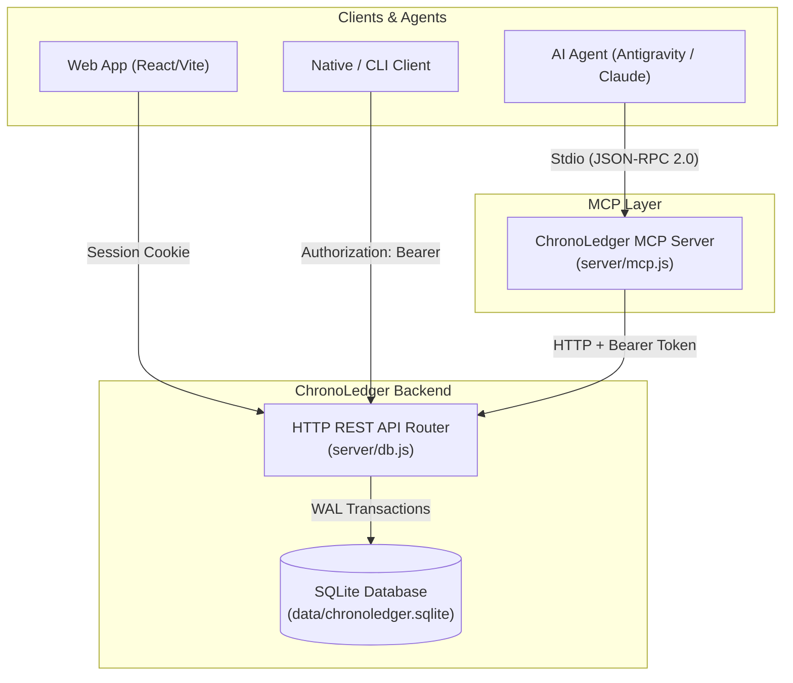

# REST API and Model Context Protocol (MCP) Server

> A comprehensive technical specification and integration guide for ChronoLedger's granular REST API, raw-text note engine, and Model Context Protocol (MCP) server.

---

## 1. Overview & Architecture

ChronoLedger provides two complementary integration interfaces:

1. **Granular REST API**: An HTTP/JSON interface for external clients (CLI tools, mobile apps, native frontends, Raycast extensions, and backend automation) to read, search, create, update, and resolve notes in real time.
2. **Model Context Protocol (MCP) Server**: A standard Stdio MCP server (`server/mcp.js`) enabling AI coding assistants and LLM agents (Google Antigravity, Claude Desktop, Cursor, Zed) to manage the calendar and tasks conversationally.



---

## 2. Ports and Environment Configuration

ChronoLedger uses dedicated ports to eliminate port collisions:

| Port | Service | Purpose |
| :--- | :--- | :--- |
| **`5173`** | Vite Dev Server | Development server running React with built-in SQLite `/api/*` middleware. |
| **`5174`** | Standalone Node Server | Production/container server (`node server/index.js`). Serves static assets and the SQLite REST API. |

### Environment Variables

| Variable | Default | Purpose |
| :--- | :--- | :--- |
| `PORT` | `5174` | Port for the standalone Node server (`server/index.js`). |
| `HOST` | `0.0.0.0` | Bind host address. |
| `DATA_DIR` | `./data` | Directory where `chronoledger.sqlite` and WAL logs reside. |
| `DATABASE_PATH` | `./data/chronoledger.sqlite` | Explicit path to the SQLite database file. |
| `CHRONOLEDGER_URL` | `http://localhost:5174` | Base URL used by the MCP server (auto-falls back to `5173` if `5174` is offline). |
| `CHRONOLEDGER_TOKEN` | _(empty)_ | Persistent 30-day Bearer token for MCP server authentication. |

---

## 3. Authentication & Bearer Tokens

The server supports **dual-mode authentication**:
- **Web browsers**: Evaluates `Cookie: session_token=<token>`.
- **API Consumers & MCP**: Evaluates `Authorization: Bearer <token>`.

### Obtaining an API Token
External clients authenticate via `POST /api/auth/login` (or `/api/auth/register`):

```bash
curl -X POST http://localhost:5174/api/auth/login \
  -H "Content-Type: application/json" \
  -d '{
    "email": "user@example.com",
    "password": "yourpassword",
    "clientName": "TerminalCLI",
    "clientType": "cli"
  }'
```

**Response (200 OK):**
```json
{
  "ok": true,
  "token": "7a3f89b1c0e4...64-char-hex-token...",
  "user": {
    "id": "usr_73a9f02c",
    "email": "user@example.com",
    "createdAt": "2026-10-15T12:00:00.000Z"
  }
}
```

Include this token in all subsequent requests:
```http
Authorization: Bearer 7a3f89b1c0e4...
```

---

## 4. The Raw-Text Note Engine

In ChronoLedger, **the Markdown string `content` is the single source of truth**.

The database stores notes strictly as text (`content TEXT NOT NULL`). There are no separate tags tables. Semantic annotations are parsed on the fly:

| Syntax | Type | Behavior |
| :--- | :--- | :--- |
| `@todo`, `@wait`, `@important`, `@celebrate`, `@explore`, `@thought`, `@time` | **Active Tag** | Renders a color-coded micro-badge. Adds notable dots to the date gutter. |
| `~~@todo~~`, `~~@wait~~` | **Resolved Tag** | Renders dimmed with a strikethrough and a 45° pencil slash indicator. |
| `\@todo` | **Escaped Tag** | Consumed on render as literal plain text `@todo` without badge styling. |
| `note.isStruck: true` | **Whole-Note Strike** | Strikes through the entire note and resolves all contained annotations. |

### Preserving Multiple Tags Losslessly
Because a note may contain multiple instances of the same tag in different states (e.g. `@wait for Alice, and ~~@wait~~ for Bob`), the API operates directly on raw text. This guarantees exact word positioning, punctuation, and context with zero ambiguity.

---

## 5. Granular REST API Reference

All routes are prefixed with `/api`.

### 5.1 Query & Filter Notes: `GET /api/notes`

Searches and filters notes across daily, weekly, and monthly scopes with support for tag resolution states and text matching.

#### Query Parameters:
| Parameter | Type | Default | Description |
| :--- | :--- | :--- | :--- |
| `scope` | string | `'all'` | Target scope: `'day'`, `'week'`, `'month'`, or `'all'`. |
| `date` | string | _none_ | Exact date in `YYYY-MM-DD` format (takes precedence over range). |
| `start_date` | string | _none_ | Range start date `YYYY-MM-DD` (inclusive). Used when `date` is omitted. |
| `end_date` | string | _none_ | Range end date `YYYY-MM-DD` (inclusive). Used when `date` is omitted. |
| `week` | string | _none_ | Week key in `YYYY-Www` format (e.g. `2026-W42`). |
| `month` | string | _none_ | Month key in `YYYY-MM` format (e.g. `2026-10`). |
| `tag` | string | _none_ | Semantic tag name without `@` (e.g. `todo`, `wait`, `important`, `celebrate`). |
| `status` | string | `'all'` | Status filter: `'all'`, `'open'` (active tag & unstruck note), or `'completed'` (resolved `~~@tag~~` or struck note). |
| `q` | string | _none_ | Case-insensitive substring match on `content`. |
| `limit` | number | `50` | Maximum notes to return (1–500). |
| `offset` | number | `0` | Pagination offset. |

#### Date & Range Precedence Rules:
1. **Exact `date` takes precedence**: When `date` is specified, it strictly matches notes on that single day (`targets.includes(date)`).
2. **Open-Ended Ranges**: If `date` is omitted:
   - `start_date` alone returns all notes on or after `start_date` ($\ge start\_date$).
   - `end_date` alone returns all notes on or before `end_date` ($\le end\_date$).
   - Both `start_date` and `end_date` return the closed interval $[start\_date, end\_date]$.

#### Example Request:
```bash
curl -H "Authorization: Bearer $TOKEN" \
  "http://localhost:5174/api/notes?tag=todo&status=open&limit=10"
```

#### Example Response (200 OK):
```json
{
  "total": 1,
  "limit": 10,
  "offset": 0,
  "notes": [
    {
      "id": "note-1729198421000-a1b2",
      "scope": "day",
      "content": "@todo Finalize Q4 architecture spec @urgent",
      "originalContent": null,
      "targets": ["2026-10-17"],
      "isStruck": false,
      "strikeStyle": null,
      "colorTag": "#51C391",
      "createdAt": "2026-10-17T14:00:00.000Z",
      "updatedAt": null
    }
  ]
}
```

---

### 5.2 Fetch Note by ID: `GET /api/notes/:id`

Retrieves a single note by ID across any scope (`notes`, `week_notes`, `month_notes`).

```bash
curl -H "Authorization: Bearer $TOKEN" \
  http://localhost:5174/api/notes/note-1729198421000-a1b2
```

**Responses**: `200 OK` with note object, or `404 Not Found`.

---

### 5.3 Create Note: `POST /api/notes`

Creates a new note with raw Markdown text.

#### Request Body:
```json
{
  "content": "@todo Ship release notes @urgent",
  "scope": "day",
  "targets": ["2026-10-17"],
  "colorTag": "#4FA3F2",
  "isStruck": false
}
```
*Note: If `targets` is omitted, defaults to today's date for `day`, the current ISO week for `week`, or the current month for `month`.*

#### Example Request:
```bash
curl -X POST http://localhost:5174/api/notes \
  -H "Authorization: Bearer $TOKEN" \
  -H "Content-Type: application/json" \
  -d '{
    "content": "@wait for Alice to review PR #42",
    "scope": "day",
    "targets": ["2026-10-17"]
  }'
```

**Response (201 Created)**: Returns the complete created `UnifiedNoteResponse`.

---

### 5.4 Update Note: `PATCH /api/notes/:id`

Performs partial updates on an existing note.

#### Request Body (all fields optional):
```json
{
  "content": "~~@wait~~ for Alice to review PR #42 (merged!)",
  "targets": ["2026-10-18"],
  "colorTag": "#51C391",
  "isStruck": false,
  "preserveDiff": false
}
```

- **`preserveDiff`**: When `false` (default for API consumers), updates `content` cleanly and sets `originalContent = null`. When `true`, saves the previous text into `originalContent` so the web interface displays paper-style red/green revision marks.

**Response (200 OK)**: Returns the updated note object.

---

### 5.5 Quick Strike Toggle: `POST /api/notes/:id/toggle-strike`

Convenience endpoint to toggle the whole-note completion status (`isStruck`).

```bash
curl -X POST http://localhost:5174/api/notes/note-1729198421000-a1b2/toggle-strike \
  -H "Authorization: Bearer $TOKEN"
```

**Response (200 OK):**
```json
{
  "id": "note-1729198421000-a1b2",
  "scope": "day",
  "isStruck": true,
  "updatedAt": "2026-10-17T18:30:00.000Z"
}
```

---

### 5.6 Delete Note: `DELETE /api/notes/:id`

Permanently deletes a note from the ledger.

```bash
curl -X DELETE http://localhost:5174/api/notes/note-1729198421000-a1b2 \
  -H "Authorization: Bearer $TOKEN"
```

**Response (200 OK):**
```json
{
  "ok": true,
  "deletedId": "note-1729198421000-a1b2"
}
```

---

### 5.7 Full State Sync & Health Endpoints

| Method | Endpoint | Description |
| :--- | :--- | :--- |
| `GET` | `/api/health` | Server uptime, SQLite database path, note/drawing counts, auth status. |
| `GET` | `/api/calendar` | Atomic retrieval of all notes, week notes, month notes, drawings, and circled dates. |
| `POST` | `/api/calendar` | Atomic sync/replacement of the user's complete calendar dataset. |

---

## 6. Model Context Protocol (MCP) Server

The MCP server ([server/mcp.js](file:///Users/dove/Code/CalendarApp/desert-estuary-calendar/server/mcp.js)) implements the open [Model Context Protocol](https://modelcontextprotocol.io/) specification over standard input/output (`stdio`).

### 6.1 Architectural Decoupling

The MCP server connects to ChronoLedger **via HTTP REST** rather than opening SQLite directly:
- **Zero Filesystem Locking**: All database locks, WAL concurrency, and migrations remain isolated in the running server process.
- **Remote Generalizability**: Works identically whether ChronoLedger is hosted locally on your machine or remotely on a VPS, home server, or Docker container.

### 6.2 Running the Server

```bash
# Run standalone
npm run mcp

# Or directly with node
node server/mcp.js
```

### 6.3 Registered MCP Tools

| Tool | Parameters | Description |
| :--- | :--- | :--- |
| **`login`** | `email`, `password` | Authenticates with credentials and activates a session token for subsequent tool calls. |
| **`list_notes`** | `scope`, `date`, `startDate`, `endDate`, `week`, `month`, `tag`, `status`, `query`, `limit`, `offset` | Queries and filters notes across the ledger. Returns formatted Markdown with note IDs. |
| **`get_note`** | `id` | Fetches full raw content and metadata for a specific note. |
| **`create_note`** | `content`, `scope`, `date`, `colorTag` | Creates a new note in the day, week, or month bucket. |
| **`update_note`** | `id`, `content`, `targets`, `colorTag`, `isStruck`, `preserveDiff` | Edits note content or properties. |
| **`toggle_note_status`** | `id`, `action`, `tag` | Performs status transitions:<br>• `action: "toggle_strike"`: Strikes through entire note.<br>• `action: "resolve_tag"`: Converts `@tag` to `~~@tag~~`.<br>• `action: "reopen_tag"`: Converts `~~@tag~~` back to `@tag`. |
| **`delete_note`** | `id` | Permanently deletes a note by ID. |
| **`get_agenda_summary`** | `date` | Returns an executive summary containing today's notes, active to-dos, and waiting-for blockers. |

### 6.4 Registered MCP Resources

AI agents can read live, self-updating context via MCP resources:

| Resource URI | Description |
| :--- | :--- |
| `chronoledger://today` | Auto-refreshing summary of notes and tasks scheduled for today. |
| `chronoledger://todos/active` | Live list of all active `@todo` items across the entire calendar. |
| `chronoledger://waiting` | Live list of all active `@wait` external dependencies. |

---

## 7. Host Configuration Guides

### 7.1 Google Antigravity Configuration
In `~/.gemini/config/mcp_config.json`:

```json
{
  "mcpServers": {
    "chronoledger": {
      "command": "node",
      "args": [
        "/Users/dove/Code/CalendarApp/desert-estuary-calendar/server/mcp.js"
      ],
      "env": {
        "CHRONOLEDGER_URL": "http://localhost:5174",
        "CHRONOLEDGER_TOKEN": "<your-30-day-bearer-token>"
      },
      "type": "stdio"
    }
  }
}
```

### 7.2 Claude Desktop Configuration
In `~/Library/Application Support/Claude/claude_desktop_config.json`:

```json
{
  "mcpServers": {
    "chronoledger": {
      "command": "node",
      "args": [
        "/Users/dove/Code/CalendarApp/desert-estuary-calendar/server/mcp.js"
      ],
      "env": {
        "CHRONOLEDGER_URL": "http://localhost:5174",
        "CHRONOLEDGER_TOKEN": "<your-30-day-bearer-token>"
      }
    }
  }
}
```

### 7.3 Cursor Configuration
In `.cursor/mcp.json`:

```json
{
  "mcpServers": {
    "chronoledger": {
      "command": "node",
      "args": [
        "/Users/dove/Code/CalendarApp/desert-estuary-calendar/server/mcp.js"
      ],
      "env": {
        "CHRONOLEDGER_URL": "http://localhost:5174",
        "CHRONOLEDGER_TOKEN": "<your-30-day-bearer-token>"
      }
    }
  }
}
```

---

## 8. Integration Recipes

### Node.js / TypeScript Recipe
```typescript
const BASE_URL = 'http://localhost:5174';
const TOKEN = 'your-bearer-token';

async function createTodo(text: string, date: string) {
  const res = await fetch(`${BASE_URL}/api/notes`, {
    method: 'POST',
    headers: {
      'Content-Type': 'application/json',
      'Authorization': `Bearer ${TOKEN}`,
    },
    body: JSON.stringify({
      scope: 'day',
      content: `@todo ${text}`,
      targets: [date],
    }),
  });
  return res.json();
}

async function getOpenTodos() {
  const res = await fetch(`${BASE_URL}/api/notes?tag=todo&status=open`, {
    headers: { 'Authorization': `Bearer ${TOKEN}` },
  });
  return res.json();
}
```

### Python Recipe
```python
import requests

BASE_URL = "http://localhost:5174"
TOKEN = "your-bearer-token"
HEADERS = {"Authorization": f"Bearer {TOKEN}"}

# List all active waiting-for blockers
response = requests.get(
    f"{BASE_URL}/api/notes",
    headers=HEADERS,
    params={"tag": "wait", "status": "open"}
)
blockers = response.json().get("notes", [])
for item in blockers:
    print(f"Blocker: {item['content']} (on {item['targets']})")
```
