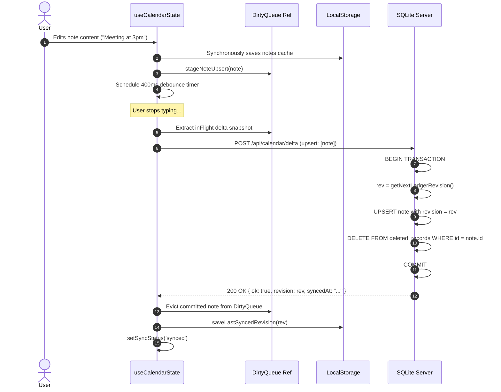
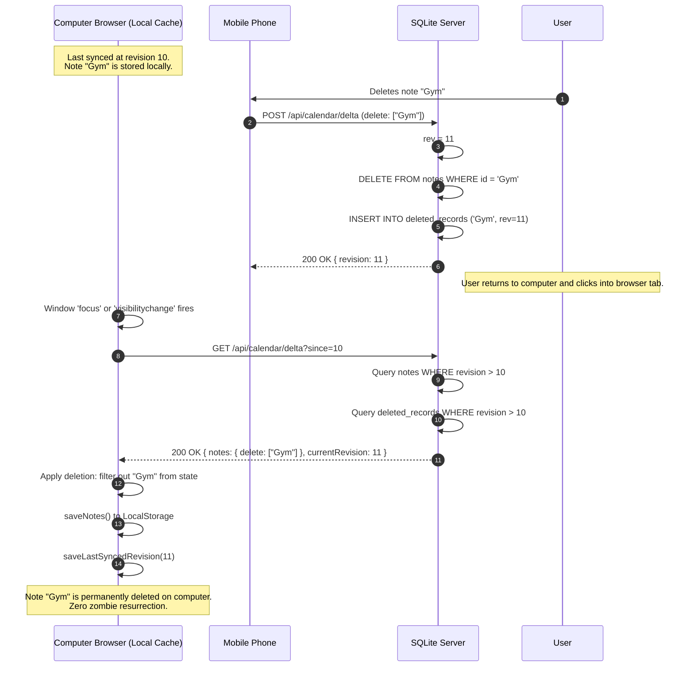
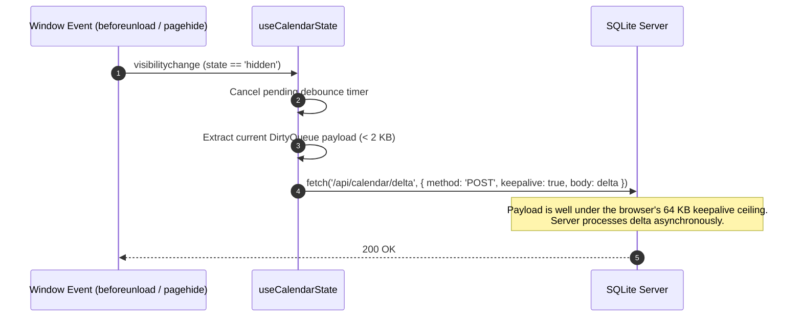
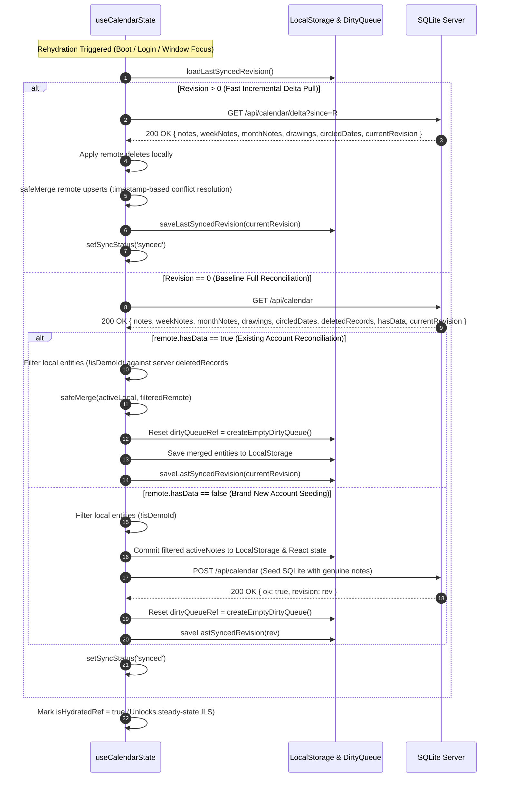
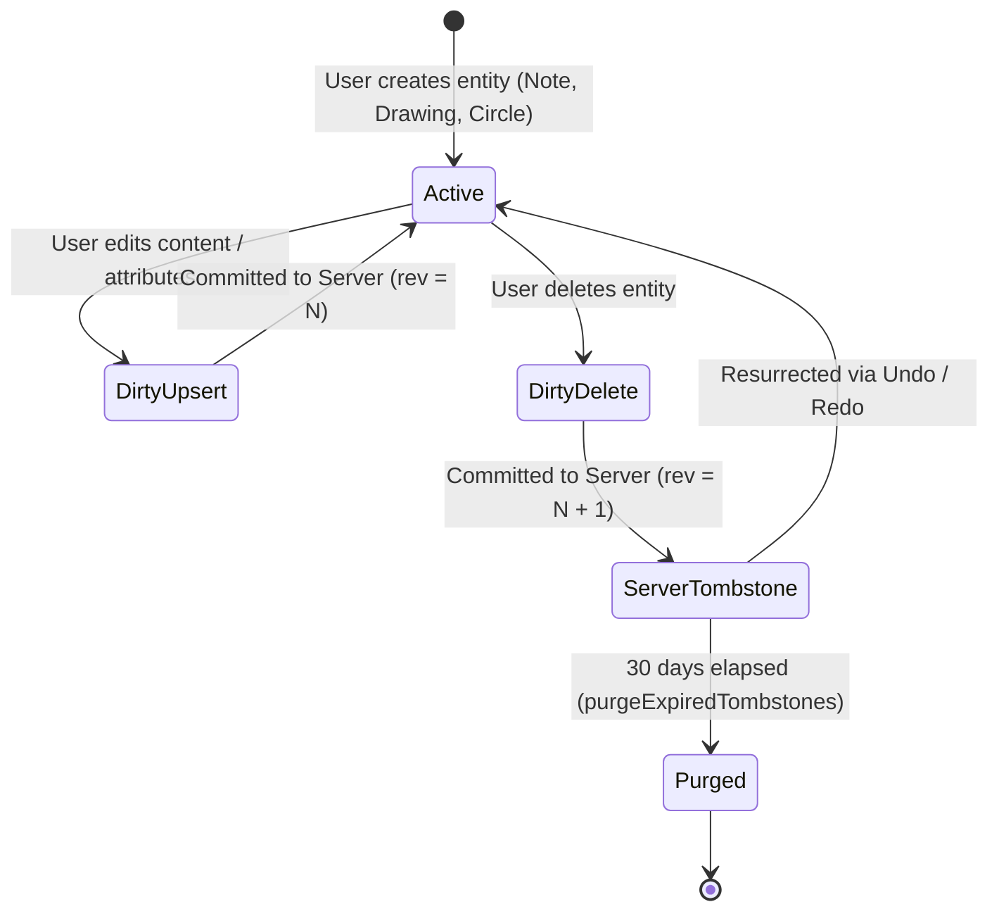

# ChronoLedger Incremental Log Sync (ILS) Architecture

This document specifies the synchronization architecture of ChronoLedger. The system implements **Incremental Log Sync (ILS)** featuring monotonic revision watermarks, row-level delta replication, client dirty queues, server-side soft-delete tombstones with automated 30-day retention policies, and cross-device consistency guarantees.

---

## 1. Background & Problem Statement

Prior versions of ChronoLedger relied on a **Full-Snapshot "Wipe-and-Replace"** synchronization model. Every 400ms after a local keystroke or canvas stroke, the entire in-memory calendar state (spanning hundreds of notes, drawings, circles, and preferences) was serialized into a large JSON blob and submitted to `POST /api/calendar`.

This legacy approach had three fundamental limitations:

1. **Cross-Device Zombie Resurrection**:
   If a user deleted an item on their mobile device and subsequently opened their desktop laptop, the laptop's local cache still retained the deleted note. During startup rehydration, an additive union merge (`safeMerge`) would observe the note locally, assume it was an offline addition, and write it back to SQLite—resurrecting the deleted item.
2. **The 64 KB Keepalive Flush Ceiling**:
   On tab close or mobile page hide (`visibilitychange` / `pagehide`), pending edits must be flushed to the server using `fetch(..., { keepalive: true })`. Web browsers silently drop or fail keepalive fetch requests whose payload exceeds **64 KB**. Full snapshots for an established calendar easily breach this limit.
3. **Database Write Amplification**:
   A single character edit or checkbox toggle caused SQLite to clear and re-insert every single database row inside a transaction, exhausting I/O and creating write contention.

---

## 2. Architectural Overview

ILS replaces snapshot overwrites with **Monotonic Revision Watermarks** and **Row-Level Delta Replication**.

```
+-----------------------------------------------------------------------------------------+
|                                    CLIENT APPLICATION                                    |
|                                                                                         |
|  [ User Action ]  --->  [ Local State ]  --->  [ Dirty Queue ]                          |
|         |                     |                      |                                  |
|         v                     v                      v (400ms Debounce)                 |
|   [ Undo/Redo ]         [ LocalStorage ]       [ In-Flight Delta Payload ]              |
|                                                      |                                  |
+------------------------------------------------------|----------------------------------+
                                                       |
                             POST /api/calendar/delta  |  GET /api/calendar/delta?since=R
                             (Lightweight: < 2 KB)     |  (Pull changes since watermark)
                                                       v
+-----------------------------------------------------------------------------------------+
|                                     SQLITE SERVER                                        |
|                                                                                         |
|   +-----------------------+     +-----------------------+     +---------------------+   |
|   |   ledger_sequences    |     |    deleted_records    |     |    Entity Tables    |   |
|   |-----------------------|     |-----------------------|     |---------------------|   |
|   | user_id (PK)          |     | id, user_id (PK)      |     | notes (unified rev) |   |
|   | current_revision (int)|     | entity_type           |     | - scope & targets   |   |
|   | updated_at (text)     |     | revision (int)        |     | drawings (rev)      |   |
|   +-----------------------+     | deleted_at (TTL 30d)  |     | circled_dates (rev) |   |
|                                 +-----------------------+     | (views: week/month) |   |
|                                                               +---------------------+   |
+-----------------------------------------------------------------------------------------+
```

### Key Principles

1. **Monotonic Sequence Ledger**:
   Each user (and anonymous guest sessions) maintains a strictly increasing integer sequence in `ledger_sequences`. Every mutating transaction atomically increments `current_revision` and tags all inserted, updated, and deleted entities with that sequence number.
2. **Unified Row-Level Revisions (Schema v8)**:
   All notes across all temporal horizons (Day, Week, Month, Year, Custom Spans) are stored in a single unified `notes` table with `scope`, `targets`, `start_at`, `end_at`, and `revision INTEGER NOT NULL`. Virtual views `week_notes` and `month_notes` provide backward compatibility. Drawings and circled dates also carry monotonic `revision` watermarks.
3. **Server-Side Tombstones**:
   Deletions are recorded in `deleted_records(id, user_id, entity_type, deleted_at, revision)`. Tombstones persist for 30 days to inform other devices that an item was deleted rather than created offline.
4. **Client-Side Dirty Queue**:
   Mutations staged between debounces are held in memory in a structured `DirtyQueue`. Only modified keys are transmitted in `POST /api/calendar/delta`.
5. **Delta Eviction on Success**:
   When the server acknowledges a delta commit and returns the new revision `R`, the client evicts *only* those specific records from its dirty queue, preserving any newer keystrokes that arrived while the network request was in flight.
6. **Graceful Watermark Invalidation**:
   If a client remains offline longer than the 30-day tombstone retention horizon, the server responds with `{ requiresFullSync: true }`, directing the client to perform a clean baseline reconciliation.
7. **Cross-Horizon In-Place Moves & Tombstone Immunity**:
   Moving notes between temporal horizons (Day $\leftrightarrow$ Week $\leftrightarrow$ Month) is executed as an in-place mutation: `UPDATE notes SET scope = ?, targets = ?, start_at = ?, end_at = ? WHERE id = ?`. Because the record is never deleted and recreated, **zero tombstones are generated**. Peer devices receive the updated note as an upsert, completely eliminating ghost duplicates and resurrection collisions.

---

## 3. Data Flow & Synchronization Sequences

### 3.1 Normal Edit & Debounced Delta Replication



---

### 3.2 Cross-Device Synchronization & Zombie Resurrection Prevention

Consider the real-world scenario where a user leaves their computer, uses their mobile phone to delete an item, and later resumes on their computer:



---

### 3.3 Fast Unload / Tab Close Flush

When closing a browser tab or switching apps on mobile:



---

### 3.4 The 3-Tier Rehydration & Baseline Reconciliation Protocol (`rehydrateRemoteCalendar`)

Rehydration runs on app boot, session authentication, window focus, and after long offline gaps. It synchronizes the client ledger against SQLite across three deterministic tiers:



#### Rehydration Guarantees
1. **Zero-Pollution Guest Migration**:
   Untouched demo blueprints (`isDemoId`) are strictly excluded prior to merging with remote notes or seeding a fresh account.
2. **Immediate State Commit for New Accounts**:
   When `remote.hasData === false`, filtered notes are committed to React state and `localStorage` before the seed POST resolves, preventing demo notes from lingering in memory.
3. **Dirty Queue Flush Isolation**:
   `dirtyQueueRef.current = createEmptyDirtyQueue()` runs during both baseline branches, ensuring stale guest operations never leak to `/api/calendar/delta`.

---

### 3.5 Defensive Guardrails in the Sync Engine (`performSync`)

The synchronization loop enforces defense-in-depth against data leakage and corruption:
1. **Hydration Gate**: `if (!isHydratedRef.current) return false;` ensures unauthenticated guest sessions never fire unauthorized sync requests.
2. **ILS Payload Sanitization**: In `POST /api/calendar/delta`, all in-flight upserts and deletes are defensively filtered through `!isDemoId(id)`, guaranteeing that demo note identifiers can never be written to SQLite rows.
3. **Delta Eviction by Timestamp**: Only items whose local `updatedAt` matches the in-flight snapshot are evicted from `dirtyQueueRef`, preserving any keystrokes typed while the network round-trip was in flight.

---

## 4. Entity Lifecycle & State Transitions



---

## 5. Database Schema & Migration Specification (Schema v7)

### 5.1 Tables

#### `ledger_sequences`
Tracks the monotonic sequence counter per user account and guest session:
```sql
CREATE TABLE IF NOT EXISTS ledger_sequences (
  user_id TEXT PRIMARY KEY,
  current_revision INTEGER NOT NULL DEFAULT 1,
  updated_at TEXT NOT NULL
);
```

#### `deleted_records`
Holds soft-delete tombstones for delta replication:
```sql
CREATE TABLE IF NOT EXISTS deleted_records (
  id TEXT NOT NULL,
  user_id TEXT,
  entity_type TEXT NOT NULL,       -- 'note' | 'week_note' | 'month_note' | 'drawing' | 'circle'
  deleted_at TEXT NOT NULL,        -- ISO 8601 UTC timestamp
  revision INTEGER NOT NULL,       -- Monotonic watermark
  PRIMARY KEY (id, user_id)
);

CREATE INDEX IF NOT EXISTS idx_deleted_records_sync ON deleted_records(user_id, revision);
CREATE INDEX IF NOT EXISTS idx_deleted_records_ttl ON deleted_records(deleted_at);
```

#### Entity Revisions
Each entity table contains a `revision INTEGER NOT NULL DEFAULT 1` column:
- `notes`
- `week_notes`
- `month_notes`
- `drawings`
- `circled_dates`

### 5.2 Retention Horizon Protection (`last_purged_rev`)

When `purgeExpiredTombstones(db, days = 30)` runs:
1. It identifies all tombstones older than 30 days (`deleted_at < datetime('now', '-30 days')`).
2. It groups by user and writes `MAX(revision)` into `metadata` under `last_purged_rev_${userId}`.
3. It purges the expired rows from `deleted_records`.

When a client requests `GET /api/calendar/delta?since=R`:
- If $R > \text{last\_purged\_rev}$, the client is within the active retention window. Incremental deltas and active tombstones are returned.
- If $R \le \text{last\_purged\_rev}$, the client's watermark falls behind deleted tombstones. The server responds `{ ok: true, requiresFullSync: true, currentRevision }`, prompting the client to run a full baseline reconciliation.

---

## 6. API Endpoint Reference

### 6.1 `GET /api/calendar/delta?since={revision}`
Fetches all mutations and deletions committed after the specified revision watermark.

- **Query Parameters**:
  - `since` (*integer*, optional, default `0`): The client's last acknowledged revision watermark.
- **Response `200 OK`**:
  ```json
  {
    "ok": true,
    "currentRevision": 42,
    "requiresFullSync": false,
    "notes": {
      "upsert": [...],
      "delete": ["note-123"]
    },
    "weekNotes": { "upsert": [], "delete": [] },
    "monthNotes": { "upsert": [], "delete": [] },
    "drawings": { "upsert": [], "delete": [] },
    "circledDates": {
      "upsert": { "2026-05-15": { "color": "#E05A47" } },
      "delete": []
    },
    "syncedAt": "2026-10-21T16:00:00.000Z"
  }
  ```

---

### 6.2 `POST /api/calendar/delta`
Commits a batch of row-level upserts and deletions.

- **Request Body (`CalendarDeltaPayload`)**:
  ```json
  {
    "notes": {
      "upsert": [{ "id": "note-456", "content": "Updated task", "parentDates": ["2026-05-10"] }],
      "delete": ["note-123"]
    },
    "circledDates": {
      "upsert": { "2026-05-10": { "color": "#4A90E2" } }
    },
    "settings": {
      "inkColor": "#4A90E2"
    }
  }
  ```
- **Response `200 OK`**:
  ```json
  {
    "ok": true,
    "revision": 43,
    "syncedAt": "2026-10-21T16:00:00.500Z"
  }
  ```

---

### 6.3 `GET /api/calendar` & `POST /api/calendar` (Baseline Sync)
Retained for initial device initialization, backup imports, and disaster recovery. When `lastSyncedRevision === 0` or after a 30-day offline gap, the client executes a baseline sync. `GET /api/calendar` includes `deletedRecords` so that local caches immediately reconcile against active server tombstones.

---

## 7. Automated Testing & Verification

A comprehensive test suite is located at [`tests/sync_ils.test.js`](file:///Users/dove/Code/CalendarApp/desert-estuary-calendar/tests/sync_ils.test.js). To execute the tests:

```bash
npm --prefix desert-estuary-calendar test
```

The test suite exercises:
1. **Schema v7 Initializer**: Validates that sequences and indexes are created with correct defaults.
2. **Monotonic Sequences**: Verifies strict sequence increments and per-user isolation.
3. **Delta Staging & Query**: Tests multi-entity upserts, deletes, and tombstone tracking.
4. **Resurrection Prevention**: Confirms that re-inserting an item purges its server tombstone.
5. **Tombstone TTL Purge**: Validates that expired records are pruned and that clients older than the purge horizon receive `requiresFullSync: true`.
6. **Guest Account Migration**: Confirms that newly registered accounts inherit all guest tombstones and continue sequence generation without discontinuity.
7. **Keepalive Payload Ceiling**: Confirms that standard delta payloads consume < 2 KB, well below the 64 KB browser limit.
